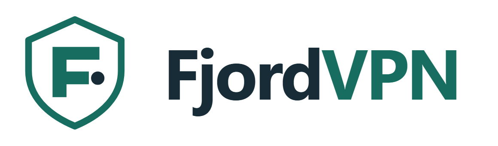

<p align="center">
  <picture>
    <source media="(prefers-color-scheme: dark)" srcset="static/brand/fjordvpn-logo-light.png">
    
  </picture>
</p>

<p align="center">Multiple Proton VPN connections, one local dashboard.<br>Upload WireGuard profiles, inspect public addresses and forward traffic to your services.</p>

## Install through FjordHub

1. Choose **FjordVPN** from the [FjordHub](https://github.com/qlerup/fjordhub) catalog.
2. Select port (default **8098**), private LAN CIDRs and data directory.
3. Open through Hub for SSO.
4. Create a VPN with a fresh Proton WireGuard `.conf` and NAT-PMP enabled.
5. Optionally configure a local TCP target; start when ready.

Only app administrators or Hub administrators with app access can enter. Managed deployments use Hub accounts, first-login email/password setup and current role/membership checks. Central required-email updates show a mandatory form when opening or returning, including existing sessions; saving clears the requirement across updated apps. Update both Hub and VPN.

Installation creates no profiles/tunnels and leaves VPN deployments on other hosts alone. The UI currently uses Danish labels.

## Requirements

- Linux, Docker and Compose v2.
- `/dev/net/tun` available to Docker with `NET_ADMIN` support.
- Proton WireGuard configuration with IPv4 and NAT-PMP/port forwarding.
- Private IPv4 LANs that do not overlap Proton's `10.2.0.0/24`.

Hub tests TUN access during installation and can provision it persistently for its own LXC through the configured Proxmox connection, without rebooting the running LXC. Standalone Proxmox deployment must pass TUN into the Docker LXC. On versions supporting device passthrough, use an **unused** `devN` slot, e.g. `pct set <CTID> --dev0 /dev/net/tun` only if free, then reboot that LXC when appropriate. FjordVPN itself does not alter Proxmox configuration.

## Standalone deployment

```sh
git clone https://github.com/qlerup/fjordvpn.git
cd fjordvpn
cp .env.example .env
# Set DATA_DIR to an absolute path and LAN_SUBNETS to your LANs.
docker compose up -d --build
```

Open `http://SERVER-IP:8098`, username `admin`; the random first password is in `DATA_DIR/initial-login.txt`. There is no shared default password. Leave both Hub URL/key empty for standalone mode.

| Setting | Purpose |
| --- | --- |
| `APP_PORT` | Web port, default 8098. |
| `DATA_DIR` | Absolute host path for private profiles/state. |
| `LAN_SUBNETS` | Comma-separated allowed private IPv4 networks. |
| `UI_ALLOWED_HOSTS` | Optional allowed domains/IPs; empty permits LAN IPs. |
| `FJORDHUB_URL`, `FJORDHUB_API_KEY` | Supplied by Hub in managed deployment. |

Flags/countries use Proton's [geofeed](https://ip.me/static/geofeeds/geofeed-mm.csv) for the active exit IP, cached six hours. Unknown locations stay unknown; this identifies the VPN location, not proven physical server geography.

## Shared HTTPS gateways

Create a separate VPN gateway with a fresh Proton configuration and up to 25 hostname targets, e.g. `app.example.com → http://192.168.1.110:8099`. Caddy routes HTTP/HTTPS and WebSockets by hostname; unknown hosts have no default target. A gateway stays off unless Start gateway is selected. The existing [setup guide](deploy/setup-guide-da.md) covers deployment/testing; that separate guide currently remains in Danish.

Cloudflare must proxy the gateway A records. FjordVPN creates/updates owned records and one owned Origin Rule, routing public port 443 to the current Proton port without browser port numbers. Unrelated rules remain; conflicting CNAME/AAAA/other records are rejected. Removed targets lose only owned A records/rule entries at the next sync. Changed/taken-over records remain; stopping the gateway does not erase DNS, and another profile's hostname cannot be taken over.

Use a zone-scoped token with **Zone / DNS / Edit**, **Zone / Zone / Read** and **Zone / Origin Rules / Edit**, and Full (strict) TLS. ACME DNS-01 issues/renews certificates; state is in `observed/caddy-data`. The token is mounted privately and not exposed to the browser or embedded in Caddy configuration. Local HTTPS targets require valid certificates and the appropriate certificate hostname; verification cannot be disabled. Apps must allow their public hostname/origin.

Gateway web ingress is restricted to Cloudflare source networks. Per-domain indicators report verified readiness. The gateway's automatic IP/port synchronization can be enabled or paused.

### Minecraft Java on the same gateway

The Gameserver section routes one local Java server through the same VPN IP/port as HTTPS. It may use another Cloudflare zone and saved token with DNS Edit/Zone Read. Automation manages DNS-only A/SRV records and checks the public status response. Bedrock/UDP forwarding is not implemented. TCP profiles can also enable automatic Minecraft SRV-port updates with DNS sync.

The image bundles Caddy 2.11.4, Cloudflare module 0.2.4 and caddy-l4 0.1.2. Systemd deployments must build `fjordvpn-app:local` or select `FJORDVPN_GATEWAY_IMAGE`; older TCP relays retain their relay image. Updating the manager briefly restarts its tunnels, so schedule around active services.

### FjordSeed on the shared VPN

An updated FjordSeed can reserve an independent NAT-PMP TCP/UDP torrent port on the gateway VPN. HTTPS/Minecraft retain their first port; torrents use a separate direct port. A dedicated seedbox profile remains available. Existing direct Flix profiles are not automatically moved to a proxied gateway.

Gateway cards show FjordSeed attachment, torrent port and green/orange/red/gray readiness. Green requires fresh worker status, matching namespace/generation, public IP and port; it is operational proof rather than a continuous speed test.

## Dedicated TCP forwarding and direct Flix delivery

Each VPN profile owns a Gluetun namespace and optional TCP relay to one LAN `IP:port`; a reverse proxy at the target can distribute HTTPS. The UI stays available while VPNs are off. Failed health checks close the relay, and assigned-port changes are followed. Other server outbound traffic is unchanged. Imported IPv6 is excluded; OpenVPN and generic UDP relays are unsupported. IP/port can change; your gateway supplies HTTPS.

### Cloudflare keys and synchronization

Save named Zone IDs/API tokens under Cloudflare keys. Blank edits preserve tokens; files use mode 0600 and secrets never return to the UI. Multiple profiles may share a key for different names. Rotate centrally; a key's zone cannot change while used. Existing per-profile keys migrate, retaining the old file for rollback.

For a TCP profile, automatic DNS requires exactly one existing A record. DNS-only synchronization needs no relay or Flix. Optional Flix stream-port sync requires a relay to an HTTPS gateway, the matching Hub-configured media domain, and `fjordflix` on the same Docker host. Only one profile may control its stream port; two profiles cannot control the same DNS name. Defaults are off; existing stream-sync choices survive updates.

Roughly every 30 seconds the app updates the DNS-only address, verifies the new HTTPS endpoint with a one-use Flix proof, then updates Flix's media port. Failed proof leaves playback configuration alone and retries. DNS propagation may delay switching; current streams may need reopening after port changes. The manual Hub guide retains its last manually saved choices. Gateway sharing also supports direct Flix targets configured for their media route.

References: [Origin Rules](https://developers.cloudflare.com/rules/origin-rules/), [destination ports](https://developers.cloudflare.com/rules/origin-rules/features/#destination-port), [DNS updates](https://developers.cloudflare.com/api/resources/dns/subresources/records/methods/edit/).

Do not reuse one Proton key in simultaneous deployments. Local duplicates are rejected, but the app cannot detect usage on other servers.

## Delete, stop and back up

Turn a profile off, wait for Off and confirm Delete. This removes its private configuration, local state and owned containers. Other profiles, shared keys, DNS and rules remain. To remove owned gateway DNS too, first remove/save its targets while synchronization runs.

Back up `DATA_DIR` privately: it contains keys, profiles and login state. It uses the same host path in VPN containers. Strict upload parsing rejects shell hooks/unrecognized configuration sections; secrets are omitted from API/errors.

Docker/Hub shutdown stops owned child containers. Desired states persist and resume at startup; children carry Compose ownership labels. Hub uninstall or `docker compose down --remove-orphans` removes runtime but keeps mounted state/keys.

Docker socket access makes this host administration software. Use trusted LAN access or HTTPS/authentication before public exposure. The UI has no Proxmox key. The alternative `deploy/` systemd installation stops only the UI when its service stops; disable tunnels in the app separately. Never run Docker and systemd against one data directory simultaneously.

## Development and artwork

```sh
python -m venv .venv
.venv/bin/pip install -r requirements.txt
.venv/bin/pip install pytest playwright pillow
.venv/bin/playwright install chromium
.venv/bin/pytest tests -q
.venv/bin/python tests/browser_check.py
```

Tests cover configuration validation, duplicates, CSRF/login, Hub SSO/revocation, resource isolation and host-path mapping with synthetic mobile/desktop fixtures. Installation/cleanup checks do not start a real VPN. See [branding](branding/README.md) and [legacy asset paths](static/brand/README.md); rebuild assets with `python tools/build_brand.py`.


### FjordHub Matrix notifications

When managed by FjordHub, VPN profiles are checked by the existing
3-second lifecycle monitor. Sustained faults generate one grouped notification
containing the *names* of failing profiles (not configuration or credentials).
Recovery generates a separate message. Manually stopped profiles are ignored.
Transient connection attempts are given 60 seconds; explicit errors 12 seconds.
The `event_notifier.py` durable queue survives restarts and retries a down
FjordHub without interrupting VPN connectivity. Delivery uses the existing
`FJORDHUB_URL`/`FJORDHUB_API_KEY` settings; no additional secret is needed.
Update FjordHub first so the authenticated notification API is available.
